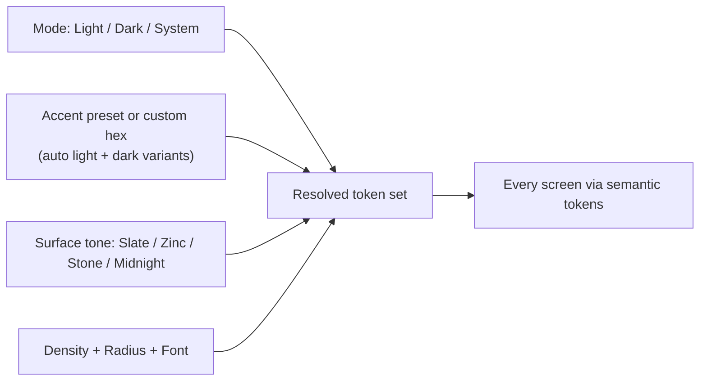

# PLAN — Enterprise UI/UX Overhaul (shadcn + ui-ux-pro-max)

> Status: **Awaiting approval.** No application code has been changed yet.
> DevPlans mirror: `devplans/PROMPT_ENTERPRISE_UIUX_OVERHAUL_SHADCN_PROMAX.md`, `devplans/PLAN_ENTERPRISE_UIUX_OVERHAUL_SHADCN_PROMAX.md`

---

## 1. Diagnosis — Why the UI is "half light, half dark"

````carousel

<!-- slide -->

<!-- slide -->

````

The previous pass only fixed the *shell* components (sidebar, chat, trace). The audit found **structural engine bugs** plus a large debt of hardcoded colors:

### 1A. Theme-engine bugs (root causes)

| # | Bug | Location | Visible symptom |
|---|---|---|---|
| E1 | Every route layout wraps the page in **`bg-slate-950`** | `app/{dashboard,studio,business,docs,admin,profile}/layout.tsx`, `app/admin/*/page.tsx`, `signin/page.tsx` (10 places) | Pitch-black central viewport in light mode (screenshot 1) |
| E2 | `@theme { --font-sans: var(--font-sans) }` **refers to itself**, so the font variable is invalid and the browser falls back to its default **serif** font | `globals.css` L71-72 | Times-like serif font everywhere (visible in all 3 screenshots) |
| E3 | `html.dark { --primary: #6366f1 }` **overrides the brand color from the DB**, so the Appearance accent only applies in light mode | `globals.css` + `theme-provider.tsx` | Orange accent in light, indigo in dark; the brand isn't respected |
| E4 | The Appearance "Canvas Background" is **one free-form hex for both modes**, so a dark hex can't be valid in light mode | `theme-provider.tsx`, `settings-dashboard.tsx` | Background contrast breaks when the mode changes |
| E5 | Tailwind v4's `dark:` variant follows the **OS media query**, not the `.dark` class, because `@custom-variant` was never declared | `globals.css` (22 `dark:` usages) | `dark:` styles fire based on the OS setting, ignoring the in-app toggle |
| E6 | Three separate theme writers (inline script, `ThemeToggle`, Appearance tab) each manipulate `classList`/`localStorage`; there's no single source of truth | `layout.tsx`, `theme-toggle.tsx`, `settings-dashboard.tsx` | Toggles drift out of sync and can cause hydration flashes |
| E7 | `@theme` used instead of `@theme inline`, and there are no tokens for sidebar, canvas, status, or chart colors | `globals.css` | Components fall back to raw hex values for anything outside the base tokens |

### 1B. Hardcoded color debt (measured)

About **3,400 hardcoded color usages across 50 files** (`bg-[#…]`, `bg-slate-*`, `text-white`, `border-slate-*`, raw hex):

| Module | Files (hits) |
|---|---|
| Command Center | `settings-dashboard.tsx` (542), `system-admin-hub.tsx` (116) |
| Business Center | `skills-registry.tsx` (256), `compliance-manager.tsx` (228), `okf-registry.tsx` (224), `knowledge-hub.tsx` (58), `business-policy.tsx` (50), `governance-console.tsx` (25), `app/business/page.tsx` (28) |
| Capability Studio | `agent-drawer.tsx` (210), `canvas-editor.tsx` (170), `app/studio/page.tsx` (160), `test-sandbox.tsx` (112), `tool-data-table.tsx` (28), `team-node.tsx` (27) |
| Admin / Profile / Docs | `user-management.tsx` (172), `demo-request-management.tsx` (117), `profile-hub.tsx` (57), `app/docs/page.tsx` (57) |
| Public / Auth | `app/page.tsx` landing (174), `obfuscated-onboard-form.tsx` (65), `demo-request-modal.tsx` (54), `signin-form.tsx` (21), `reset-password` (16) |
| Shared | `markdown-editor.tsx` (90), `ai-assist-button.tsx` (21), `help-tooltip.tsx`, `access-denied.tsx` |
| **Exempt** | `tool-gateway.ts`, `otp.ts`, `invitations/route.ts`, `test-email/route.ts`, `orchestrator/test/route.ts`. These are **email HTML templates**, which need inline hex for mail clients. |

There is also **no shadcn foundation**: no `components.json`, no `components/ui/`, no `cn()` utility, no `next-themes`. Every screen hand-rolls its own buttons, inputs, tables, and modals.

---

## 2. Skill-Driven Direction

**ui-ux-pro-max** (`--design-system`, query *"B2B enterprise SaaS AI agent orchestration dashboard"*) returned:
- **Style:** *Trust & Authority*, an enterprise style rated WCAG AAA. Corporate neutral base (navy/slate) with restrained accents.
- **Typography:** *Plus Jakarta Sans*, recommended for SaaS, dashboards, B2B, and productivity tools.
- **Anti-patterns to avoid:** playful design, *AI purple/pink gradients*, hidden credentials.
- **Contrast rules:** light-mode muted text no lighter than **slate-600 `#475569`** (the current token is `#64748b`, which is too light), visible borders in both modes, and glass surfaces at ≥ 80% opacity in light mode.

**shadcn** rules adopted:
- Semantic tokens only (`bg-primary`, `text-muted-foreground`), with **no manual `dark:` color overrides**.
- `:root` + `.dark` variable sets and `@theme inline` (Tailwind v4).
- Compose primitives: Card, Tabs, Table, Dialog, Sheet, Badge, Alert, Skeleton, Sonner. Use `cn()` for conditional classes, `gap-*` instead of `space-*`, and `size-*` for square elements.

---

## 3. Target Design System (`DESIGN.md` v2)

### 3.1 Layered theme model: Mode × Accent × Surface

The Appearance experience is built from three **independent** choices that always resolve to valid colors in both modes:



Each accent and surface preset ships a **light and a dark variant**, plus an automatically computed foreground. This removes the "single hex for both modes" class of bugs (E3, E4).

### 3.2 Surface elevation hierarchy

| Level | Token | Light (Slate) | Dark (Slate) | Used by |
|---|---|---|---|---|
| L0 Canvas | `--background` | `#f8fafc` | `#0b0e14` | Page viewport, chat canvas |
| L1 Rails | `--sidebar` | `#ffffff` | `#0f131a` | Left nav, System Trace, Studio palette |
| L2 Surface | `--card` | `#ffffff` | `#131821` | Cards, tables, nodes, chat bubbles |
| L2b Subtle | `--muted` | `#f1f5f9` | `#1a202b` | Table headers, code, inactive tabs |
| L3 Floating | `--popover` | `#ffffff` | `#171d27` | Dropdowns, menus, tooltips |
| L4 Modal | `--card` + `--overlay` | `#ffffff` / `rgb(15 23 42 / .45)` | `#131821` / `rgb(0 0 0 / .6)` | Dialogs, sheets |
| Text | `--foreground` / `--muted-foreground` | `#0f172a` / `#475569` | `#e6e9ef` / `#9aa4b5` | Body text and secondary text |
| Lines | `--border` / `--input` | `#e2e8f0` / `#cbd5e1` | `#252c38` / `#303847` | Dividers, inputs |

Dark mode moves off pure black (`#06060b`) to a slate-tinted base. This reduces halation and makes the elevation steps visible.

### 3.3 New semantic token families

- **Status:** `--success`, `--warning`, `--info`, `--destructive`, each with `-foreground` and a `-subtle` variant for badges. Category pills such as *MCP Binded*, *Native TS*, and *Custom JS* map to these tokens instead of raw amber or emerald classes.
- **Sidebar:** `--sidebar`, `--sidebar-foreground`, `--sidebar-accent`, `--sidebar-border` (shadcn sidebar contract).
- **Studio canvas:** `--canvas`, `--canvas-grid`, `--edge`, `--edge-active`, `--node-supervisor`, `--node-specialist`, `--node-team`, `--node-synth`.
- **Charts:** `--chart-1` … `--chart-5` (Usage & Spend tab).
- **Shape and rhythm:** `--radius` (sm/md/lg derived), 4/8 px spacing grid, z-index scale (10/20/30/40/50).

### 3.4 Accent presets (each defined for light and dark)

| Preset | Light primary | Dark primary | Note |
|---|---|---|---|
| Ocean (default per pro-max) | `#0369a1` | `#38bdf8` | Trust/authority blue |
| Indigo | `#4f46e5` | `#818cf8` | Current default |
| Teal | `#0f766e` | `#2dd4bf` | |
| Emerald | `#047857` | `#34d399` | |
| Saffron | `#c2410c` | `#fb923c` | Closest to your current orange brand |
| Amber | `#b45309` | `#fbbf24` | Dark text on primary |
| Rose | `#be123c` | `#fb7185` | |
| Violet | `#6d28d9` | `#a78bfa` | |
| Graphite | `#0f172a` | `#e2e8f0` | Monochrome executive look |
| **Custom hex** | Lightness clamped to a safe range | Lightness lifted for dark backgrounds | Uses OKLCH math; foreground picked by WCAG ratio |

Every preset × mode × surface combination is checked by an automated **contrast test script**: text ≥ 4.5:1, UI boundaries ≥ 3:1. The build fails if any combination misses.

### 3.5 Typography and spacing
- Font: **Plus Jakarta Sans** (headings and UI) with **JetBrains Mono** for code and IDs, both loaded via `next/font` (this also fixes E2). Inter and System remain selectable in Appearance.
- Scale: 12 / 13 / 14 (base UI) / 16 (prose, prompt) / 18 / 20 / 24 / 30. Line height 1.5 for body text, 1.25 for headings, prose capped at 72ch.
- Density: *Comfortable* (default) or *Compact* (tables and Studio), driven by a `--density` multiplier.

### 3.6 Theme Transition Contract
1. **One writer:** `next-themes` (`attribute="class"`, `enableSystem`, `disableTransitionOnChange`). All toggles call `setTheme()`. No direct `classList` writes anywhere else.
2. **No viewport-level colors:** layouts and pages may only use `bg-background` / `bg-sidebar` / `bg-card`.
3. **Banned patterns** (enforced in CI by `npm run lint:theme`): `bg-[#`, `text-[#`, `border-[#`, `bg-slate-*`, `bg-gray-*`, `bg-zinc-*`, `bg-black`, `text-white` (allowed only via `text-primary-foreground`), and `dark:` color utilities. Email templates are allow-listed.
4. **Two-mode evidence:** every UI change ships Playwright screenshots in light and dark mode.

---

## 4. The New Appearance Studio (Command Center → Appearance)

A redesigned tab with a **live preview**. Changes apply instantly and persist on Save:

```
┌ Appearance ──────────────────────────────────────────────────────────┐
│ Mode         [ ☀ Light ] [ ☾ Dark ] [ 🖥 System ]                     │
│ Accent       ● Ocean ● Indigo ● Teal ● Emerald ● Saffron ● Amber …   │
│              [ Custom ▢ #____ ]  ✓ AA contrast in light ✓ in dark    │
│ Surface      [ Slate ] [ Zinc ] [ Stone ] [ Midnight ]                │
│ Radius       ( 0 · 4 · 8 · 12 )      Density  ( Comfortable | Compact)│
│ Font         [ Plus Jakarta Sans ▾ ]  Prompt size [ 16px ▾ ]          │
│ ┌ Live preview (side-by-side Light | Dark mini-canvases) ───────────┐ │
│ │ sidebar · chat bubble · table row · button · badge · input        │ │
│ └───────────────────────────────────────────────────────────────────┘ │
│ [ Reset to defaults ]                              [ Save Appearance ] │
└──────────────────────────────────────────────────────────────────────┘
```

- **Contrast badges** warn in real time if a custom hex fails AA in either mode, and show the auto-adjusted value.
- The raw "Canvas Background hex" control is **replaced** by Surface tone presets (fixes E4). Existing DB values migrate to the nearest preset.
- Data model (`design_tokens`, no schema change): `{ themeMode, accentPreset, accentCustom, surfaceTone, radius, density, fontSans }`.
- `ThemeProvider` emits an `html[data-accent][data-surface]` attribute set plus CSS for both modes. It no longer emits a single `:root` primary override.

---

## 5. Per-Screen Overhaul Scope

| Screen | Key changes |
|---|---|
| **Agent Workspace** | Remove `bg-slate-950` shell; L0 canvas, L1 trace rail; chat via shadcn chat rules (Message/Bubble); prompt bar as L2 elevated surface; status badges via status tokens; markdown/code blocks tokenized |
| **Capability Studio** | Canvas grid, edges, minimap, zoom controls via `--canvas*` and `--edge*`; node cards by role token; Team containers as dashed `--border` groups; toolbar uses shadcn Button variants; Agent Drawer becomes a `Sheet`; Test Sandbox tokenized |
| **Business Center** | Catalog nav as `Sidebar` group; registries use shadcn `Table` with sticky muted header, row hover, and truncation; category pills use `Badge` + status-subtle tokens; search uses `InputGroup`; filters use `ToggleGroup` |
| **Command Center (9 tabs)** | `Tabs` primitive; each section as a `Card`; forms as `Field`/`FieldGroup`; JSON editors as tokenized mono surfaces; sticky save footer; MCP/DB/API modals use `Dialog` |
| **User Admin / Demo Requests** | Tables, pending queue, 53-permission matrix (sticky first column, check icons with status tokens), modals use `Dialog` |
| **Docs / Profile** | Prose typography (72ch), tokenized code snippets, profile cards |
| **Landing / Sign-in / Onboarding / Reset** | Tokenized hero and sections following the pro-max *Enterprise Gateway* pattern (no purple/pink AI gradients); auth cards as L2 surfaces on L0 canvas; both modes supported |
| **Shared** | `markdown-editor`, `ai-assist-button`, `help-tooltip` (shadcn `Tooltip`), `access-denied` (shadcn `Empty`), toasts via `sonner` |

---

## 6. Execution Phases

| Phase | Work | Outcome |
|---|---|---|
| **0. Foundation** | `npx shadcn@latest init` (radix base, Tailwind v4, lucide); add `next-themes`, `clsx`, `tailwind-merge`, `cva`, `tw-animate-css`, `sonner`; rewrite `globals.css` tokens (`@theme inline`, `@custom-variant dark`, font fix); new `ThemeProvider` (next-themes + DB accent/surface); unify all toggles; remove `bg-slate-950` from all layouts | **Split-viewport bug gone on every route** |
| **1. Primitives** | `shadcn add` button card input textarea label select switch tabs dialog sheet dropdown-menu popover tooltip table badge separator skeleton scroll-area toggle-group alert sonner field input-group empty | Shared, token-pure building blocks |
| **2. Module sweeps** (parallel, isolated workspaces) | Wave A: Workspace + Shared. Wave B: Studio. Wave C: Business. Wave D: Command Center. Wave E: Admin/Docs/Profile. Wave F: Public/Auth | All ~3,400 hits removed (minus email allow-list) |
| **3. Appearance Studio** | Presets, custom-hex OKLCH derivation, live dual preview, DB migration of legacy `background` | Brand control that works in both modes |
| **4. Guardrails** | `scripts/lint-theme.mjs` (banned patterns) + `scripts/check-contrast.mjs` (all presets × modes) wired into `npm run lint` | Prevents regressions |
| **5. QA and release** | Playwright screenshots of 12 routes × 2 modes × 2 accents; `npx tsc --noEmit`, `npm run build`, `graphify update .`, `docker compose down && up --build -d`; WALKTHROUGH; commit and push | Verified evidence |

---

## 7. Verification Plan
- **Automated:** `lint:theme` reports 0 violations; `check-contrast` passes every preset × surface × mode; `tsc` and `next build` pass with 0 errors.
- **Visual:** Playwright captures `/`, `/signin`, `/dashboard`, `/studio`, `/business` (3 sub-tabs), `/admin/settings` (9 tabs), `/admin/users` (3 tabs), `/docs`, `/profile` in light and dark mode. Screenshots are embedded in the WALKTHROUGH.
- **Behavioral:** no flash of the wrong theme on hard reload; mode toggle syncs across sidebar, Appearance tab, and other browser tabs; System mode follows the OS.

---

## 8. Risks
- **Scale:** about 40 files touched. Mitigated by phase-0-first (it fixes most of the visible breakage on its own) and by module waves with build gates between them.
- **Behavioral regressions** in large components (`settings-dashboard.tsx` is about 2,500 lines). Sweeps change **className strings only**; logic stays untouched.
- **Network:** `shadcn` and npm installs need network access (run with approval).

---

## 9. Decisions Needed From You

1. **Default accent:** keep your current **orange (Saffron)** as the brand default, or switch to pro-max's **Ocean blue**?
2. **Font:** adopt **Plus Jakarta Sans** (pro-max recommendation) or stay on **Inter**?
3. **Who controls appearance:** (a) Admin sets org defaults only, or (b) org defaults **plus** per-user overrides for mode and accent in the Profile Hub *(recommended)*?
4. **shadcn depth:** (a) token sweep + shadcn primitives for shared patterns (buttons, inputs, tables, dialogs, tabs, badges), keeping existing layouts *(recommended; lower risk)*, or (b) a full rewrite of every screen onto shadcn composition (much bigger change)?
